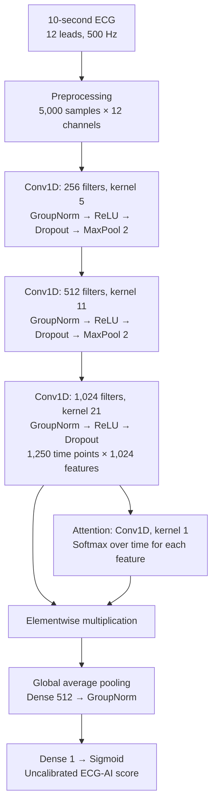

# ECG-AI cardiomyopathy risk prediction

Model weights and an ECG preprocessing example accompanying **ECG-based Cardiomyopathy Risk Prediction in Childhood Cancer Survivors Using Artificial Intelligence** (Patterson and colleagues).

The model uses a 10-second, 12-lead ECG to produce a score for the study's five-year cardiomyopathy prediction task. It was developed in SJLIFE and evaluated externally in DCCSS-LATER. This repository provides the frozen neural model used in the manuscript, its numerical weights, model-input preparation and a fully synthetic example. It contains no patient ECGs, identifiers, outcomes or participant-level predictions.

For the original training task, case ECGs preceded cardiomyopathy by more than one and up to five years; control ECGs had at least five years of cardiomyopathy-free follow-up.

The output is an **uncalibrated ECG-AI score between 0 and 1**, not a patient's absolute five-year risk. The clinical/Cox models and separate calibration analyses are not included. This is a research model; it has not been validated for clinical decision-making or changes to echocardiographic surveillance.

## Model diagram



The network has **14,048,513 parameters**. Group normalization uses 32 groups and epsilon 0.001. Dropout is disabled during inference. The architecture is defined in [`ecgai/model.py`](ecgai/model.py); [`weights/manifest.json`](weights/manifest.json) records the weight checksum and tensor shapes.

## Quick start

Use **Python 3.11** and run the commands from the repository root. A CPU is sufficient; a GPU is optional. Install dependencies in a dedicated environment to avoid changing another project's packages:

```bash
git clone https://github.com/akbilgic/ECG-AI_CardiomyopathyRiskPrediction_SJLIFE-LATER.git
cd ECG-AI_CardiomyopathyRiskPrediction_SJLIFE-LATER
python3.11 -m venv .venv
source .venv/bin/activate
python -m pip install -r requirements.txt
python -m ecgai.predict --synthetic
```

An already activated, dedicated conda environment can be used instead of creating `.venv`. The default requirements were tested with TensorFlow 2.21.0 / Keras 3.13.2. For a separate TensorFlow 2.15.0 / Keras 2.15.0 environment, install `requirements-tf215.txt` **instead of** `requirements.txt`. Both configurations were tested on Python 3.11 with CPU inference. Do not mix Keras 2 with TensorFlow 2.21, or Keras 3 with TensorFlow 2.15.

The command prints JSON containing `ecgai_score`, `score_type` and `synthetic_example`. The demonstration waveform is generated from mathematical functions; its score has no clinical meaning.

## Preparing a local ECG

Provide one numerical `.npy` array containing a **10-second, 500 Hz, 12-lead ECG**, with shape `(5000, 12)` or `(12, 5000)`; a leading singleton dimension is also accepted.

The preparation function checks the shape and finite values, converts to `float32`, and orients the array as 5,000 samples by 12 channels. It preserves the amplitude scale and channel order, without filtering, amplitude normalization, resampling, padding or cropping. The original SJLIFE raw-export parser was unavailable, so the input must already match the study's amplitude scale and channel order; these cannot be verified from array shape alone.

```bash
python -m ecgai.predict --input /path/to/prepared_ecg.npy
```

The same preparation and inference functions can be called directly:

```python
import numpy as np
from ecgai.preprocessing import prepare_model_array
from ecgai.model import load_model, predict_scores

array = np.load("/path/to/prepared_ecg.npy", allow_pickle=False)
ecg = prepare_model_array(array)
score = float(predict_scores(load_model(), ecg)[0])
```

See [`ecgai/preprocessing.py`](ecgai/preprocessing.py) for the input checks.

## Verification and data handling

```bash
python -m unittest discover -s tests -v
```

All public tests use generated signals. The released weights are numerically identical to the original manuscript checkpoint's layer weights; optimizer state was removed. The loader verifies the release checksum before inference. Numerical fidelity was checked in both supported TensorFlow configurations; small floating-point differences across hardware or versions are possible.

The example runs locally and does not transmit inputs. Keep private ECGs and results outside the repository. Common data-file formats and local outputs are excluded by `.gitignore`. An optional synthetic file can be generated with `python -m examples.generate_synthetic_ecg --output outputs/synthetic_ecg.npy`; no waveform file is bundled.

## License

Code and model weights are available under the **PolyForm Noncommercial License 1.0.0** for noncommercial use, modification and redistribution, including research. See [`LICENSE`](LICENSE) and [`THIRD_PARTY_NOTICES.md`](THIRD_PARTY_NOTICES.md). Dependencies retain their own licenses.

For questions about the model or permission for other uses, contact the corresponding authors through the study publication or this repository. Publication details will be added when available.
